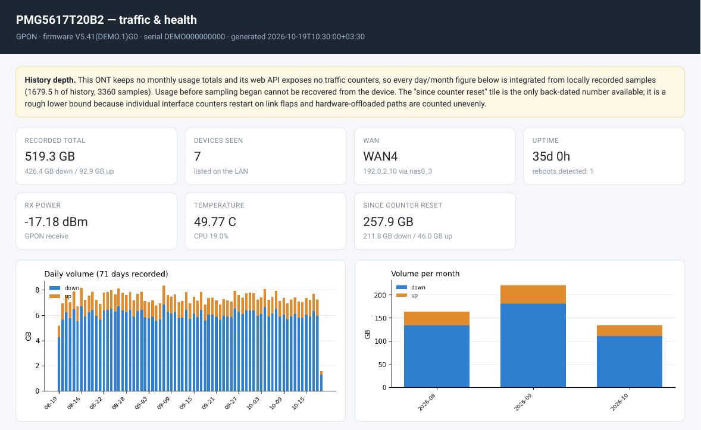
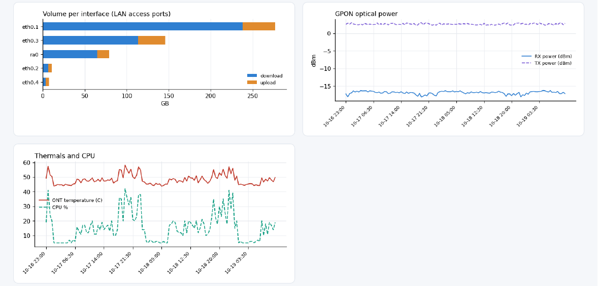
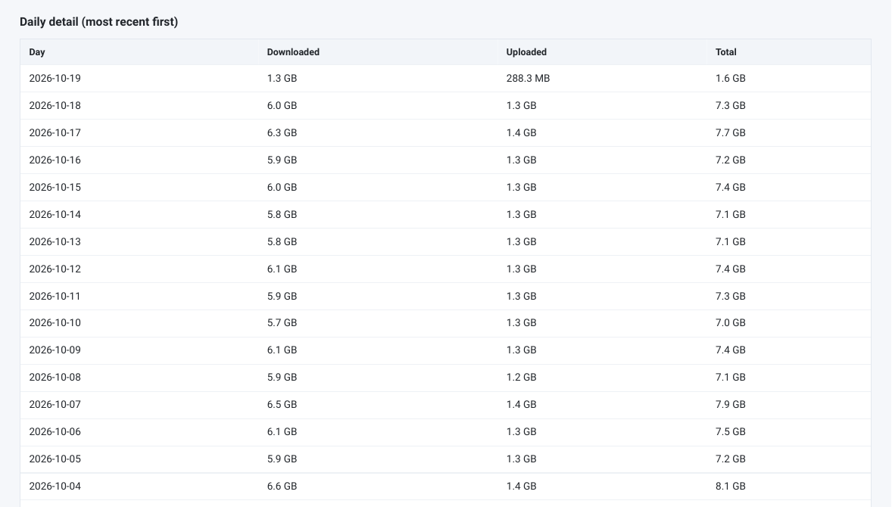

# Zyxel BW Monitor

Traffic and health monitoring for Zyxel GPON/fiber ONTs: a small Python tool that
logs into the router's web API, reads its SNMP interface counters, keeps a local
history in SQLite and renders a fully offline HTML dashboard with charts.

Tested on a **Zyxel PMG5617T20B2** (GPON, firmware `V5.41(ACBB.1)G0`). Other Zyxel
ONTs exposing the same `DAL` web API and SNMP agent should work unchanged, but
only that one model has actually been tested.

> ### Read this first: the ONT stores no usage history
>
> There is no "past months" figure to fetch from the device. The web API exposes
> **no byte counters at all** — not per day, not per month, not per session. The
> only traffic data on the device is the running `ifHCInOctets`/`ifHCOutOctets`
> counters exposed over SNMP, which start from zero at every interface flap and
> are lost on reboot.
>
> So this tool does the honest thing: it **samples those counters on a schedule
> and integrates the deltas locally**. Historical usage before you started
> sampling is unrecoverable from the device — start the recorder and the numbers
> become useful from day one onward.

## What you get

| File | Purpose |
| --- | --- |
| `read_usage.py` | One-shot reader: live rates, optics, WAN/LAN status, device list. With `--record` it appends to the history DB. |
| `dashboard.py` | Renders `dashboard.html` — tiles, daily/monthly/per-port volume, optical power, thermals, daily table. |
| `zyxel_client.py` | Authenticated client for the ONT web API (RSA+AES wrapped `DAL` requests). |
| `snmp_client.py` | Dependency-free SNMPv2c GET/walk (hand-rolled BER), used for the counters. |
| `make_demo_data.py` | Synthetic history DB so you can preview the dashboard without a device. |
| `setup.sh` / `setup.ps1` | Installers for Linux/macOS and Windows. |

*Headline tiles and daily/monthly volume:*



*Per-port breakdown, GPON optical power and thermals:*



*Daily table, newest first:*



Every screenshot comes from `make_demo_data.py`, not from a real line.

## Requirements

* Python **3.9+**
* Network access to the ONT from the machine running this (same LAN segment)
* The ONT's admin credentials, and SNMP enabled on the device
* ~200 MB of disk for the Python packages (`requests`, `cryptography`,
  `matplotlib` and their numpy/pillow dependencies)

## Install

### Linux and macOS

```sh
git clone https://github.com/<you>/zyxel-bw-monitor.git
cd zyxel-bw-monitor
./setup.sh
source .venv/bin/activate
```

`setup.sh` picks the newest available `python3`, creates `.venv/` and installs the
dependencies. If it reports a missing `venv` module on Debian/Ubuntu:
`sudo apt install python3-venv`.

### Windows

```powershell
git clone https://github.com/<you>/zyxel-bw-monitor.git
cd zyxel-bw-monitor
powershell -ExecutionPolicy Bypass -File .\setup.ps1
.\.venv\Scripts\Activate.ps1
```

### Without git

Download the repository as a ZIP (Code → Download ZIP), unpack it and run the
setup script from inside the folder.

## Prepare the ONT

1. Sign in to the web UI (`http://192.168.1.1` or `https://192.168.1.1`).
2. Check **Maintenance → SNMP**: the agent must be enabled and you need the
   *read* community string (this tool defaults to `public`, override with
   `--community`). Nothing is written to the device; only GET/GETNEXT requests
   are sent.
3. Confirm the counters are reachable from the machine that will do the polling:

   ```sh
   python read_usage.py --host https://192.168.1.1 --snmp-host 192.168.1.1
   ```

   Enter the admin password when prompted — or set `ZX_PW` beforehand (see
   [Configuration](#configuration)).

**Before you rely on this device long-term, please read
[Security notes](#security-notes).** Enabling SNMP and password-based API login
on an ISP-managed ONT has real downsides.

## Usage

### One-shot read

```sh
python read_usage.py
```

```
PMG5617T20B2  fw V5.41(ACBB.1)G0  WAN GPON  (session level: medium)
up 12d 4h   first use 2026-01-05T09:00:00
optics: rx -17.2 dBm   tx 2.6 dBm   49.8 C   3.24 V
wan: WAN4 via nas0_3  ip 192.0.2.10
cpu 19.0%   mem 226.6 MB total   devices 7

live rates over 5.02s
  iface       role            down            up since counter reset
  eth0.1      lan     99.20 Mbit/s   6.40 Mbit/s            257.9 GB
  ra0         lan      9.60 Mbit/s   1.10 Mbit/s             61.2 GB
  eth0.3      lan          0 bit/s       0 bit/s              9.4 GB
  nas0_3      wan    160.00 kbit/s  32.00 kbit/s            312.0 GB
  pon         wan    160.00 kbit/s  32.00 kbit/s            312.4 GB

  moved in this window (LAN access ports): 69.6 MB  [65.1 MB down / 4.5 MB up]
  totals sum per-port counters; aggregates (eth0, br0) are excluded to avoid double counting
  recorded -> usage_history.db
```

Illustrative values; the WAN rows are shown to make the point that they barely move.

Useful flags: `--json` (machine-readable output), `--interval 15` (longer
sampling window for the live rates), `--record usage_history.db`.

### Record history

The dashboard is only as good as the sample rate, so run the recorder on a
schedule. Every run appends one row of health data plus one row per interface:

```sh
python read_usage.py --record usage_history.db
```

A 5-minute cadence writes roughly 3,700 rows a day (one health row plus one row
per interface) and grows the database by about 0.4 MB, so a full year stays near
150 MB.

**Linux — systemd user timer** (logs to the journal, and `Persistent=true` catches
up runs missed while the machine was asleep or off):

`~/.config/systemd/user/zyxel-bw-monitor.service`

```ini
[Unit]
Description=Sample Zyxel ONT usage

[Service]
Type=oneshot
WorkingDirectory=%h/zyxel-bw-monitor
ExecStart=%h/zyxel-bw-monitor/.venv/bin/python read_usage.py \
    --record %h/zyxel-bw-monitor/usage_history.db \
    --password-file %h/.config/zyxel-bw-monitor/password
```

`~/.config/systemd/user/zyxel-bw-monitor.timer`

```ini
[Unit]
Description=Sample Zyxel ONT usage every 5 minutes

[Timer]
OnBootSec=2min
OnUnitActiveSec=5min
RandomizedDelaySec=20
Persistent=true

[Install]
WantedBy=timers.target
```

```sh
systemctl --user daemon-reload
systemctl --user enable --now zyxel-bw-monitor.timer
systemctl --user status zyxel-bw-monitor.timer
```

To keep sampling with no user session active (a headless box):
`sudo loginctl enable-linger "$USER"`.

**Linux and macOS — cron:**

```cron
*/5 * * * * cd $HOME/zyxel-bw-monitor && .venv/bin/python read_usage.py \
  --record usage_history.db --password-file "$HOME/.config/zyxel-bw-monitor/password" \
  >> "$HOME/.local/state/zyxel-bw-monitor.log" 2>&1
```

**Windows — Task Scheduler:**

```powershell
$root = "C:\zyxel-bw-monitor"
$action  = New-ScheduledTaskAction -Execute "$root\.venv\Scripts\python.exe" `
           -Argument "read_usage.py --record usage_history.db --password-file $root\ont.pw" `
           -WorkingDirectory $root
$trigger = New-ScheduledTaskTrigger -Once -At (Get-Date) `
           -RepetitionInterval (New-TimeSpan -Minutes 5)
Register-ScheduledTask -TaskName "Zyxel BW Monitor" -Action $action -Trigger $trigger
```

Create `ont.pw` as a single-line file containing the admin password and restrict
it to your account:

```powershell
icacls ont.pw /inheritance:r /grant:r "$($env:USERNAME):R"
```

### Build the dashboard

```sh
python dashboard.py                       # -> dashboard.html, last 90 days
python dashboard.py --days 30 --out out.html
```

Open the file in a browser. Charts are embedded as base64 PNGs, so the page works
offline, from a USB stick, or emailed to yourself. Re-run it whenever you want
fresh numbers, or add it to the same schedule right after the recorder.

### Preview without a device

```sh
python make_demo_data.py --days 70
python dashboard.py --db demo_history.db --out demo_dashboard.html
```

Generates a synthetic 70-day history (documentation IP range, `DEMO` serial) —
this is what the screenshots above show.

## Configuration

Everything is command-line flags, with environment fallbacks. Nothing is written to
disk except the history DB and the HTML report you ask for.

| Setting | Flag | Environment | Default |
| --- | --- | --- | --- |
| ONT web UI | `--host` | `ZX_HOST` | `https://192.168.1.1` |
| SNMP agent | `--snmp-host` | — | `192.168.1.1` |
| Username | `--username` | `ZX_USER` | `admin` |
| Password | `--password` / `--password-file` | `ZX_PW` | *(required)* |
| SNMP read community | `--community` | — | `public` |
| Live-rate window | `--interval` | — | `5.0` seconds |
| History DB | `--record [DB]` | — | off; `usage_history.db` if the flag has no value |
| Trusted TLS certificate | — | `ZX_CA` | *(verification off)* |
| Dashboard window | `--days` | — | `90` |
| Dashboard output | `--out` | — | `dashboard.html` |

Password resolution order: `--password` → `--password-file` → `$ZX_PW` → an
interactive prompt (only when attached to a terminal). Prefer `--password-file`
or a per-user env file for scheduled runs; `--password` is visible in the process
list.

## How the numbers are computed

Getting honest totals out of this device required working around three things:

* **Only LAN access ports see the traffic.** This ONT hardware-offloads bridged
  subscriber traffic, so the WAN-side counters (`pon`, `nas0_3`) stay nearly flat
  while real downloads run. The per-host ports (`eth0.1`…`eth0.4`) and the radio
  interfaces (`ra0`, `rai0`) do count it, so those are summed.
* **Directions are inverted on an access port.** `ifInOctets` on `eth0.1` is
  traffic arriving *from* your device — an upload. `read_usage.py:directions()`
  maps this correctly; it was verified against a controlled 50 MB download.
* **Aggregates would double count.** `eth0` and `br0` carry the same frames as
  their member ports, so they are classified `other` and excluded.

Because per-interface counters reset on link flaps, the tool stores raw
cumulative values and derives deltas between consecutive samples; any negative
delta, reboot or gap longer than 3 days is discarded rather than guessed at. The
"since counter reset" tile is the only back-dated number the device offers and is
labelled as a rough lower bound.

## Security notes

Please treat these as part of the install, not as an afterword.

* **SNMP write access.** ONTs frequently ship with SNMP enabled and default
  communities. If your read community is `public`, the *set* community is very
  likely `private` — meaning anyone on your LAN can rewrite the device
  configuration. Restrict SNMP to the polling host, change both communities, or
  disable the agent when you are not sampling.
* **Cleartext management access.** If HTTP (port 80) is enabled on the LAN side,
  the login form and the API payloads — including the Wi-Fi PSK — travel in
  cleartext. Prefer HTTPS-only management and disable HTTP.
* **The admin password is the whole ballgame.** This tool logs in as the web
  admin, which on this firmware means it can read the Wi-Fi PSK and every other
  secret in the config. Keep the password in a `chmod 600` file or in `$ZX_PW`;
  never commit it, and never pass it as a `--password` argument on a shared
  machine. The history DB and the generated HTML contain no credentials.
* **TLS verification is off by default** because the device uses a self-signed
  certificate. Export `ZX_CA=/path/to/device.pem` to pin it instead of accepting
  any certificate.
* **ISP-managed devices.** Changing SNMP/management settings on an operator
  provisioned ONT can break remote support or violate your service terms. Check
  before you change anything, and be able to restore the previous values.
* **Scope.** Point this at your own equipment only.

## Troubleshooting

| Symptom | Cause / fix |
| --- | --- |
| `login failed: ZCFG_...` | Wrong credentials, or the account lacks the privilege level the API needs. Some ISPs expose a lower-privilege admin. |
| `device returned no RSA public key` | The firmware's login flow differs from the DAL scheme handled in `zyxel_client.py`; capture the login POST from your browser's dev tools and compare. |
| SNMP request times out | The agent is disabled, the community is wrong, or management access is restricted to a specific host/VLAN. |
| `no samples in ...db` | Run `read_usage.py --record` first; the dashboard never invents data. |
| Totals look far too low | The recorder was not running during that traffic — deltas can only be measured between samples. |
| A day is missing entirely | A reboot or counter reset during that interval is dropped on purpose rather than guessed at. |
| Charts are empty for WAN | Expected: WAN-side counters are not trusted on this hardware (see above). |
| `ModuleNotFoundError: requests` | The virtualenv is not active (`source .venv/bin/activate` / `.\.venv\Scripts\Activate.ps1`). |

## License

MIT — see [LICENSE](LICENSE).
